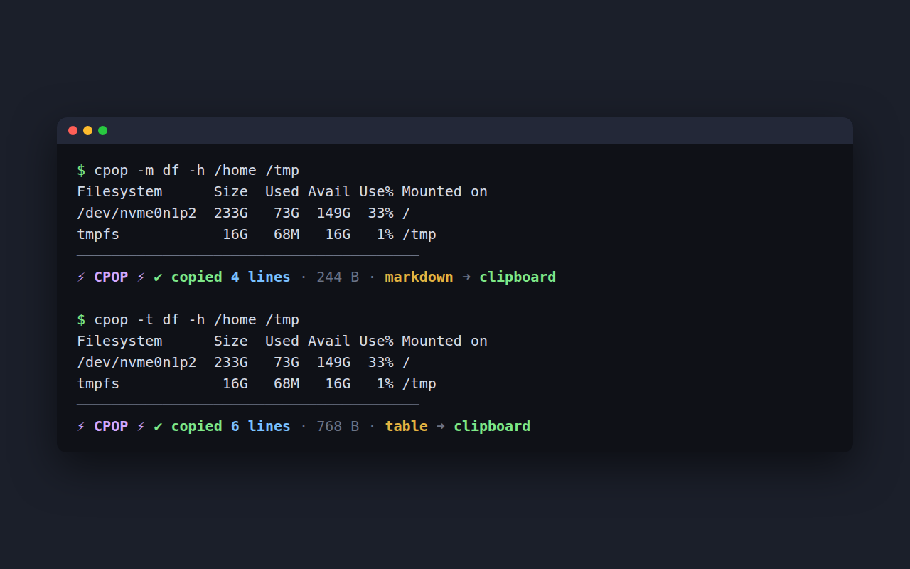

# cpop

**C**opy **OP**utput: put `cpop` in front of any command and its output lands on your system clipboard.

```console
$ cpop ls -a
.
..
cpop
install.sh
────────────────────────────────────────
⚡ CPOP ⚡ ✔ copied 4 lines · 34 B ➜ clipboard
```



Shorter than `command | xclip -selection clipboard`, and it still prints the output so you can see it.

## Install

```bash
git clone <this repo> && cd cpop
./install.sh            # installs to ~/.local (or /usr/local when run as root)
./install.sh /some/prefix
./install.sh --uninstall
```

This installs the `cpop` command, its man page (`man cpop`) and tab completion for bash, zsh and fish. Make sure `<prefix>/bin` is on your `PATH`.

- **bash:** completion loads automatically in new shells (needs the `bash-completion` package).
- **zsh:** add `fpath=(~/.local/share/zsh/site-functions $fpath)` to `~/.zshrc` before `compinit`.
- **fish:** picked up from `~/.config/fish/completions`.

Completion covers `cpop`'s own flags and also the wrapped command, so `cpop git sta<TAB>` completes `git` subcommands. The bash and man page installs are tested; the zsh and fish completion files have not been run.

## Usage

```bash
cpop [flags] <command> [args...]
cpop git log --oneline -5
cpop sh -c 'ls | wc -l'     # quote pipelines so they run inside cpop
cpop --help
```

- Output is shown live **and** copied (stdout and stderr together).
- The command's exit code is passed through, so `cpop make && ...` still works.
- ANSI colors are stripped from the copy so you paste plain text (use `-r` to keep them).
- If the command prints nothing, the clipboard is left untouched.

### Format flags

These change only what goes on the clipboard. Your terminal still shows the command's normal output.

| Flag | Clipboard gets |
| --- | --- |
| `-t`, `--table` | aligned box-drawn table |
| `-m`, `--markdown` | Markdown table |
| `-j`, `--json` | JSON: table becomes an array of objects, other text an array of lines, existing JSON is pretty-printed |
| `-p`, `--pretty` | best guess: pretty-printed if it is JSON, otherwise a box-drawn table |
| `-c`, `--code` | wrapped in a Markdown code fence (combines with the flags above) |
| `-r`, `--raw` | keep ANSI colors |
| `-q`, `--quiet` | hide the banner (or set `CPOP_QUIET=1`) |

Short flags can be bundled (`cpop -mc df -h`). Use one of `-t`/`-m`/`-j`/`-p` at a time.

```console
$ cpop -m df -h /home /tmp
...
⚡ CPOP ⚡ ✔ copied 4 lines · 196 B · markdown ➜ clipboard

| Filesystem     | Size | Used | Avail | Use% | Mounted on |
| -------------- | ---- | ---- | ----- | ---- | ---------- |
| /dev/nvme0n1p2 | 233G | 73G  | 149G  | 33%  | /          |
| tmpfs          | 16G  | 66M  | 16G   | 1%   | /tmp       |
```

How tables are built: columns split on whitespace, the width is the most common word count of the data rows, extra words stay in the last column, and the first full-width line is the header. That works well for `df`, `ps`, `docker ps`, `lsblk` and similar. Commands without a header row (like `ls -l`) treat the first row as the header, and columns with spaces in the middle (like `ps -o lstart`) get split. If the output isn't tabular, cpop copies it unchanged and says so. Format flags need `python3`.

Because output goes through a pipe, some programs turn off colors while running under `cpop`. Use their `--color=always` flag if you want them on screen.

The banner is colored on terminals; `NO_COLOR=1` turns the color off. On non-UTF-8 locales it and the tables fall back to plain ASCII.

## Clipboard backends

cpop picks the first one that fits your session: `wl-copy` (Wayland), `xclip`, `xsel` (X11), `pbcopy` (macOS), `clip.exe` (WSL). Install one of these if cpop reports none found (`sudo apt install wl-clipboard` or `xclip`).

## License

MIT
